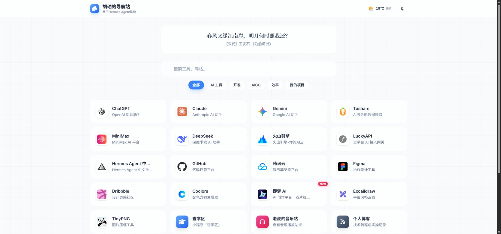
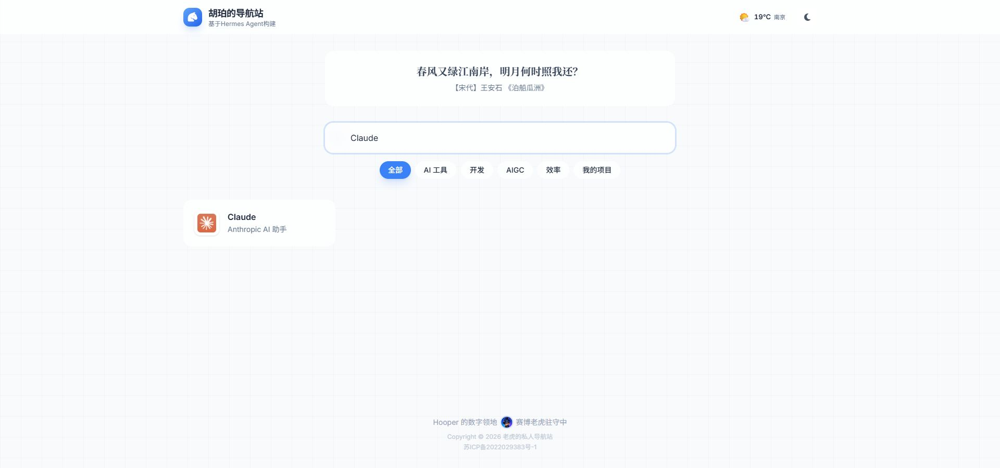
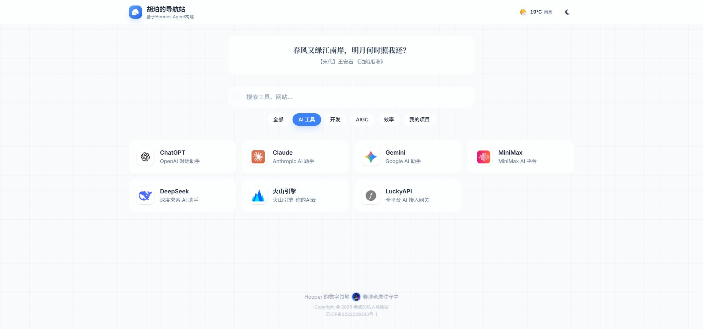
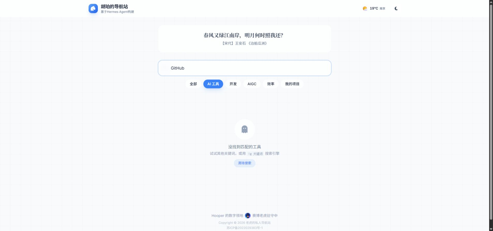
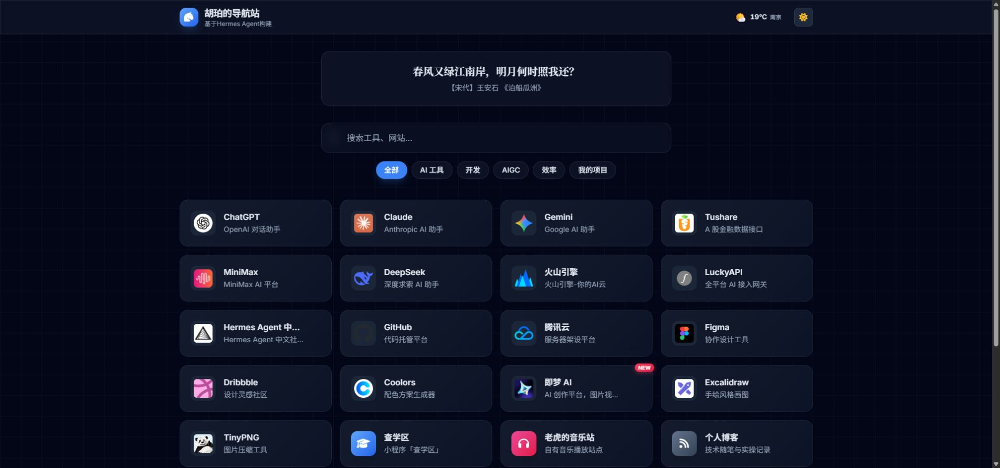
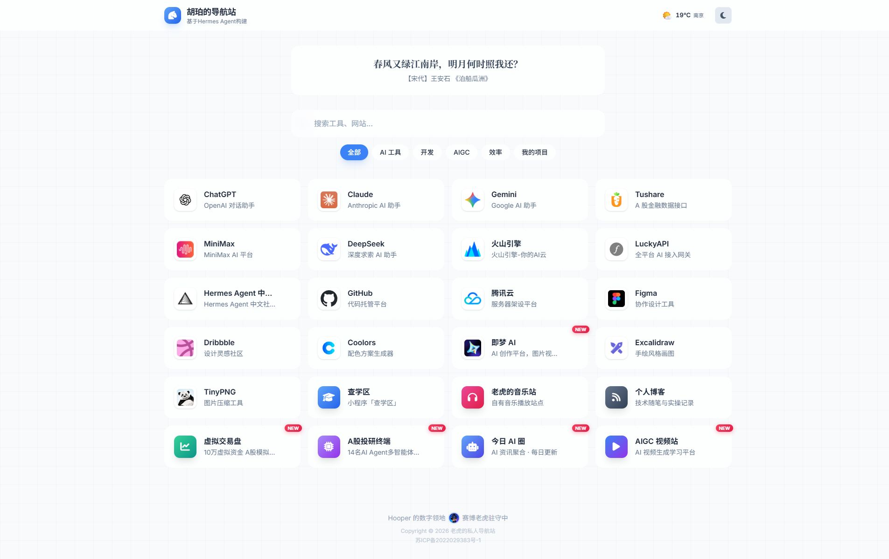

# 原站首页审查与第一轮优化方案

实施更新（2026-10-15）：用户已同意此方案，独立本地精修版已完成，地址 `http://127.0.0.1:18869/`。见 [实现与运行说明](../preview-original/README.md)、[验收记录](../preview-original/design-qa.md)。以下保留审查时的原始测量和设计目标；原版及线上未替换。

核对日期：2026-10-15（北京时间）。目标页面为 `http://127.0.0.1:18866/`，对应 `public/index.html` 原站首页。这份方案以当前原站为基础；不采用此前实验稿，不修改线上或已保留的 18867 深浅两版。

## 结论与范围

原站的 24 个入口、熟悉的网站图标、浅色卡片、搜索／分类、天气与诗词可以继续沿用。第一轮主要修正空间分配、文字截断、搜索预期和收藏入口；不需要迁移到 React 或无限画布，也不需要新增首页大模块。

以下均来自本轮浏览器检查与当前源码核对。历史记忆未作为审查证据。当前原站源码、线上与此前 Demo 没有修改；浏览器已恢复浅色、全部分类、空查询，未改收藏。

## 检查步骤与证据

### 1. 首页容量：不满足一屏目标

- 1920×1080 下，当前诗句和内容的页面高度约 1200px；页脚从 y=1100 开始，完整页脚不在视口内。
- 1920×900 下，仅前 20 个入口完整可见，最后 4 个入口从 y=914 开始，位于屏外。
- 第一个网址到 y=384 才出现；诗词、搜索、分类和间距消耗了较大的首屏高度。
- 主容器最大宽度 1280px，实际网址网格 1216px；宽屏两侧留白较多。
- 当前网格 4 列 × 6 行，单卡约 292×90px、间隔 16px，总高 620px。

测量证据：[measurements.json](original-site-audit-20261015/measurements.json)。补充完整页面见步骤 6。

### 2. 网址卡片：入口明确，长文字被截断

- 名称、图标和简短介绍的排列容易理解，16px 标题与 14px 说明可以继续保留。
- 在标准宽屏下，Hermes Agent 中文社区标题被截断；即梦、虚拟交易盘、A股投研终端说明也超出可用宽度。
- 浏览器测得文字区域宽约 154px，Hermes 标题需要约 179px，最长说明约 197px；图标、内边距与右侧操作列共同挤占了空间。
- 名称没有完整文本提示。静态 NEW 标记没有新增日期或到期机制，长期展示会削弱“新增”的含义。
- 收藏是卡片中的可点击 `<i>`，没有按钮语义、名称、按下状态或 Tab 焦点。无需改变卡片风格，也应改善其操作方式。

证据同首页截图；结构与样式核对 `renderCard()`、`.fav-star`、`.badge-new`。

### 3. 搜索：即时过滤可用，回车预期需要统一

- 实际输入 Claude 得到 1 个本地结果，Escape 可清除；`/` 聚焦搜索的逻辑存在并已检查。
- 输入时表现为站内过滤；回车处理函数却默认打开 Google，并清空本地查询。这一行为来自本轮源码核对，未实际发送外网搜索。
- 搜索框只有占位文字，没有独立可访问名称，也没有结果数量或清除按钮。
- 筛选每次重建全部卡片，重新执行入场动画。全部状态最后一张卡片延迟 690ms，动画持续 500ms，完成展示需约 1.19 秒；本轮曾捕获到分类卡片仍在淡入的中间状态，该截图已拒绝并补拍。

### 4. 分类与空状态：功能可用，范围反馈不足

- AI 工具分类实际得到 7 条，回到全部可恢复 24 条。
- 分类与查询取交集；AI 工具中搜索 GitHub 得到空状态，虽然 GitHub 在“开发”分类里。
- 空状态没有解释当前分类范围，仅提供“清除搜索”；点清除后回到 AI 工具 7 条，不能直接搜索所有分类。
- “清除搜索”是不可通过 Tab 到达的 ``。分类选中态只有样式变化，没有 `aria-pressed` 状态。
- 收藏已有本地保存与优先排序功能，但没有“常用／收藏”筛选入口。

### 5. 键盘与小控件：可访问性需补齐

- 搜索框没有独立标签，深浅切换按钮没有可访问名称。
- 收藏星、诗词刷新、天气预报和空状态恢复并非完整的键盘可操作按钮；当前分别使用 `<i>`、`
` 或 ``。
- 天气预报依赖鼠标悬停显示；没有键盘／触屏打开入口。没有在自动化中把点击当成真实悬停来证明这一浮层。
- 占位文字与页脚使用 `#94A3B8`；对 `#F8FAFC` 页面底色的近似对比度为 2.45，文字较淡。玻璃表面的实际混色会略有不同，此数字不是完整无障碍认证。
- 此轮没有使用屏幕阅读器，没有验证系统减少动态效果或手机触屏交互。

### 6. 主题与品牌：切换可用，细节不统一

- 深浅切换正常，已还原浅色；深色 GitHub 图标对比度不足。
- 当前深色为偏蓝的 `#020617` 背景和渐变卡片；与此前偏好的中性深石墨有所区别。
- 页头“胡珀的导航站”、元信息“赛博黑马”、页脚“赛博老虎”混用，身份文字不一致。
- “基于 Hermes Agent 构建”占用常驻副标题，可移到关于或页脚，给站点本身让出层级。
- 当前页脚内容高约 100px，前面还有 64px 间距，共占约 164px。

## 第一轮具体改法：原位精修

继续保持“页头 → 诗词 → 搜索和分类 → 网站卡片 → 页脚”的阅读顺序，优先让原站变得紧凑、清楚、稳定。

| 项目 | 当前实测 | 首轮设计目标（尚未实施） |
| --- | --- | --- |
| 宽屏容器 | 最大 1280px | 约 1440px，保持居中和正常边距 |
| 网址网格 | 4 列 × 6 行 | 先保留 4 列 × 6 行，利用更大的文字空间 |
| 诗词区 | 约 106px，外间距较大 | 约 68–76px，保留诗词与来源，减轻过粗字重 |
| 搜索框 | 58px | 约 52px，补充清除、快捷键与搜索范围提示 |
| 卡片 | 约 90px，图标底座 48px | 约 80px，图标底座约 44px，标题 16px、说明 14px |
| 卡片间距 | 16px | 约 12px |
| 第一个入口位置 | y=384 | 目标约 y=290，具体以长诗句实测为准 |
| 页脚与前间距 | 合计约 164px | 约 40–48px，必要信息清晰可读 |
| 一屏范围 | 页面约 1200px 高 | 当前 24 条在 1920×1080 和 1920×900 均完整显示 |

这些是尺寸预算，不是已验证的新布局。若实际长文本不满足预算，应调整排布，不能用 `overflow:hidden`、整体缩放或裁切内容掩盖。

### A. 卡片与字体

1. 保留原站 Inter／Noto Sans SC 与现有网站图标，只统一底座、对齐和间距。
2. 增加有效文字宽度，确保 24 个名称完整显示；说明优先通过宽度解决，较窄窗口再采用合理换行或完整文本提示。
3. 统一约 12–14px 圆角，降低阴影与玻璃模糊强度；保留卡片层次但减少“每层都发光”的效果。
4. 悬停改为 100–160ms 的边界／底色变化，不再同时执行卡片上浮 4px、图标放大和强阴影；键盘聚焦提供同等清晰反馈。
5. NEW 提示先降低视觉强度；只有具备真实新增时间后，再做自动到期，不能补造时间。

### B. 搜索、分类与收藏

1. 默认站内搜索。回车定位或打开当前选中结果；全网搜索通过明确的前缀提示／入口表达，保留现有 `!g` 等快捷方式。
2. 增加简短状态文字，例如“AI 工具 · 7 个网站”；空状态提供“搜索全部分类”和“清空关键词”两个可操作恢复路径。
3. 使用现有收藏数据增加“常用”入口，保留用户收藏；收藏使用独立按钮及 `aria-pressed`，键盘可操作。
4. 筛选更新不重播卡片入场动画，不让结果逐张重新出现；输入、选择分类和清空应即时稳定。
5. 给搜索、主题切换、诗词刷新和天气预报补齐名称、焦点、Enter／Space 与触屏操作。

### C. 品牌与配色

1. 使用用户已经提供的 `hooper.svg` 替换页头标记，站名先沿用原站，统一页头、页签和页脚的表述。
2. 浅色保留原站冷灰、浅蓝强调和熟悉的卡片感，改善淡文字与卡片边界；网站主色继续避开纯黑、纯白。
3. 深色可使用之前认可的中性深石墨，确保与浅色共用同一排版；对 GitHub 等深色图标做适配。
4. 诗词保留为个人氛围，构建来源放次要位置，页脚的个人形象可保留为小元素。

## 顺序与验收

第一轮顺序：空间和卡片尺寸 → 搜索与收藏 → 字体、反馈和主题细节。先形成一个基于原站的独立本地精修版，与 18866 原版并排核对；18867 深浅两版继续保留。此轮审查没有实施该精修版。

验收要求：

- 1920×1080 与 1920×900、浏览器缩放 100%，24 个入口、诗词、搜索、分类和必要页脚均完整可见，无页面／面板滚动、无整体缩小或裁切。
- 24 个名称清楚可读，Hermes Agent 等不再仅显示省略号；正常字号和点击面积不缩水。
- 搜索 Claude、跨分类搜索、无结果恢复、常用筛选、收藏与取消、键盘操作、深浅切换都有可验证结果。
- 搜索与分类不再触发所有卡片逐张入场，焦点不丢失。
- 笔记、图片收集与密码管理在首页精修验收后单独接入；公开浏览、仅站主登录编辑的要求保持有效。

## 源码及验证边界

- 本轮 UI 实测使用原站本地副本，没有逐个访问外部网址，也没有发起 Google 查询、修改收藏、验证登录或写入服务器。
- 天气本轮成功显示；不能据此保证第三方服务长期可用。天气失败时的可理解状态和重试可在实现时补充。
- 控制台未捕获 error，存在 Tailwind CDN 的生产使用提示。后续正式发布应使用构建后的本地 CSS，并评估字体／图标依赖的加载失败表现；第一轮无需为此迁移整套框架。
- 保持原始 68 文件基线及现有两个方案，未部署或替换任何线上资源。
